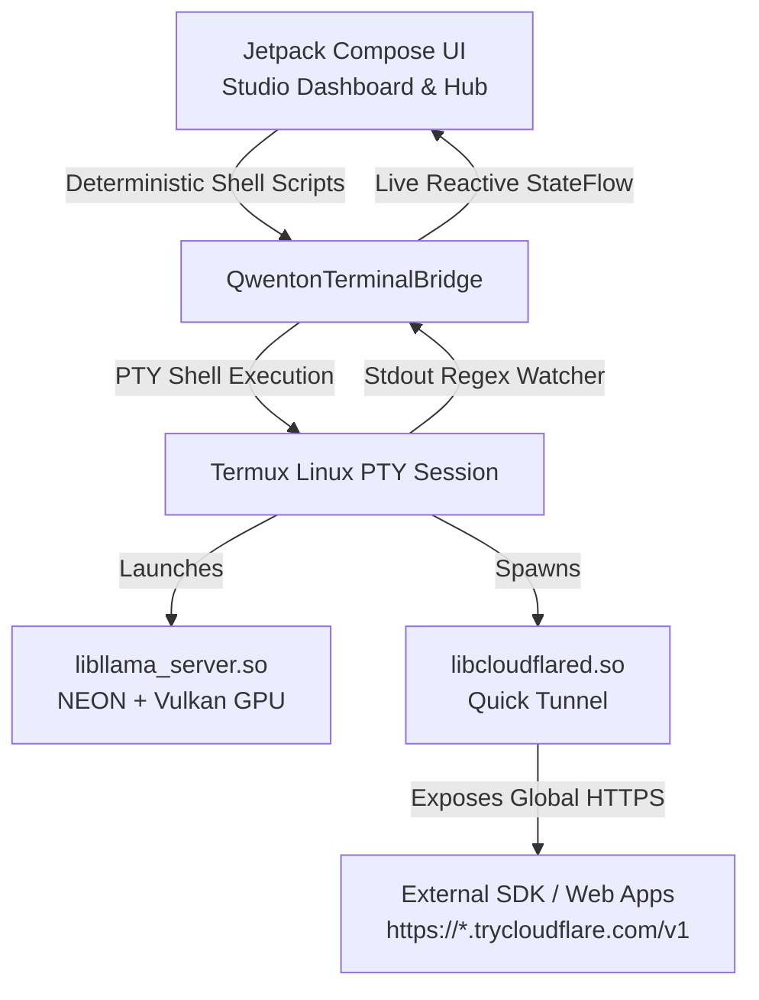

# ⚡ Qwenton-Studio-apex

[-3DDC84?style=for-the-badge&logo=android&logoColor=white)](https://developer.android.com)
[-FF6F00?style=for-the-badge&logo=arm&logoColor=white)](https://developer.arm.com)
[](https://developer.android.com/jetpack/compose)
[-00C853?style=for-the-badge&logo=shield&logoColor=white)](./.agent/security_report.md)
[](./LICENSE)

> **LM Studio for Android.** Host, run, and port-forward quantized GGUF Large Language Models (LLMs) and custom autonomous agents directly on your Android smartphone with 1-click UI controls, an embedded Linux PTY terminal, and zero manual shell typing.

---

## 📖 Table of Contents
- [Executive Overview](#-executive-overview)
- [Key Features](#-key-features)
- [Core Architecture Pillars](#-core-architecture-pillars)
- [Design System & UI/UX](#-design-system--uiux)
- [Project Directory Structure](#-project-directory-structure)
- [Getting Started & Setup](#-getting-started--setup)
- [External SDK Usage (Python & Node.js)](#-external-sdk-usage)
- [Security & Pentest Audit](#-security--pentest-audit)
- [License](#-license)

---

## 🌟 Executive Overview

**Qwenton-Studio-apex** transforms modern Android smartphones into standalone, self-hosted AI servers. Built natively with **Jetpack Compose (Obsidian Glassmorphism)** and an embedded **Linux PTY Terminal (`TerminalSession`)**, it eliminates the friction of running local AI on mobile devices.

Every step—bootstrapping the Linux rootfs, installing GGUF models, launching the `llama.cpp` OpenAI server, and port-forwarding via Cloudflare Quick Tunnels—is handled seamlessly through high-level UI controls.



---

## 🚀 Key Features

- **Zero Manual Commands:** 1-Click UI buttons trigger background shell pipelines, monitor curl download percentages, parse token generation speeds, and capture dynamic URLs automatically.
- **Android 10–15+ W^X Security Bypass:** Circumvents Android's restrictive `W^X` policy by packaging ARM64 binaries (`libllama_server.so`, `libcloudflared.so`, `libproot.so`) disguised as shared libraries in `jniLibs/arm64-v8a/` with `android:extractNativeLibs="true"`.
- **Public HTTPS Base URL:** Exposes a globally reachable OpenAI-compatible endpoint (`https://*.trycloudflare.com/v1`) secured by custom `sk-qwenton-apex-*` API keys.
- **Pre-Flight RAM & Hardware Guardrails:** Real-time memory inspection queries `ActivityManager.MemoryInfo`. If a model exceeds 65% of available RAM, `--ctx-size` auto-tunes to 2048 and CPU threads are scaled to prevent Low Memory Killer (LMK) crashes.
- **Collapsible Live Terminal Drawer:** Swipe-up bottom sheet embedding Termux `TerminalView` directly inside a Compose `AndroidView`, featuring Clear, Copy, and Process Kill controls.
- **Persistent Android Foreground Service:** Holds `PARTIAL_WAKE_LOCK` and `WIFI_MODE_FULL_LOW_LATENCY` with an ongoing notification and quick "Stop Server" action.

---

## 🏛️ Core Architecture Pillars

### 1. W^X Binary Extraction via `jniLibs`
Android blocks executing binaries downloaded into writable application storage (`filesDir`). Qwenton packages native ARM64 binaries into `app/src/main/jniLibs/arm64-v8a/`:
- `libllama_server.so`: Optimized `llama.cpp` HTTP server with ARM NEON, dotprod, and Vulkan GPU offloading.
- `libcloudflared.so`: Cloudflare Quick Tunnel binary to route around mobile carrier CGNAT.
- `libproot.so`: Rootless execution layer allowing Alpine/Ubuntu ARM64 Linux rootfs execution for Python pip agents.

Setting `android:extractNativeLibs="true"` instructs Android's package manager to extract these binaries into `context.applicationInfo.nativeLibraryDir` with read/execute (`r-x`) permissions.

### 2. Dual-Channel Terminal Bridge (`QwentonTerminalBridge`)
- **Downward Flow (UI -> PTY):** Dispatches deterministic shell scripts generated by `ShellScriptFactory` into `TerminalSession.write()`.
- **Upward Flow (PTY -> UI):** A streaming regex watcher parses `stdout` in real time:
  - Curl download percentages (`(\d{1,3})%`)
  - Token speed metric (`([0-9.]+)\s*t/s`)
  - Dynamic Cloudflare URL (`https://*.trycloudflare.com`)
  - Studio lifecycle tokens (`[QWENTON_READY]`, `[QWENTON_INIT_COMPLETE]`)

### 3. Hardware-Backed API Key Security
API keys formatted as `sk-qwenton-apex-<24-hex-chars>` (96-bit cryptographic entropy) are stored in `EncryptedSharedPreferences` backed by the Android Keystore's AES256-GCM `MasterKey`. Keys are excluded from automatic cloud backups via `data_extraction_rules.xml`.

---

## 🎨 Design System & UI/UX

Qwenton Studio follows an **Obsidian Glassmorphic** aesthetic engineered for OLED battery conservation and visual clarity:

### The 60-30-10 Color Harmony Rule
- **60% Dominant Canvas:** `ObsidianSlate` (`#0B0E14`) & `ObsidianSurface` (`#111622`) — Battery-saving deep black canvas for OLED screens.
- **30% Structural Glass:** `DarkCyanSurface` (`#0F293A` @ 75% opacity) & `CyanBorder` (`#00BCD4` @ 35% opacity) — Form the top header bar, bottom taskbar, and glassmorphic cards.
- **10% Hero Accent:** `SoftPink` (`#F48FB1`) for primary actions ("Start Server", "Download", "Send") paired with `MetallicGold` (`#FFD54F`) for hardware telemetry.

### Typography
- **Primary Interface:** Android System Sans-Serif (`FontFamily.Default` / Roboto) across titles, body text, and dialogs.
- **Technical Readouts:** Fixed-width `FontFamily.Monospace` (Roboto Mono) for terminal logs, token generation speeds, URLs, and code blocks.

---

## 📁 Project Directory Structure

```
Qwenton-Studio-apex/
├── .agent/                             # AI context & living state documentation
│   ├── project_state.md                # Master state documentation
│   ├── security_report.md              # Full defensive SAST pentest report
│   ├── security_review_guide.md        # Safety and threat model review guide
│   └── ui_ux_specification.md          # Visual tokens and interaction blueprint
├── .plan/
│   └── roadmap.md                      # 5-phase project execution roadmap
├── app/
│   ├── build.gradle.kts                # App module configuration & dependencies
│   └── src/main/
│       ├── AndroidManifest.xml         # Permissions, Foreground Service & W^X config
│       ├── jniLibs/arm64-v8a/          # Native ARM64 binaries (libllama_server.so, etc.)
│       ├── res/                        # Themes, strings, network security config
│       └── java/com/qwenton/studio/apex/
│           ├── MainActivity.kt         # Main Compose Activity & Scaffold shell
│           ├── QwentonApplication.kt   # Application context & singleton provider
│           ├── data/
│           │   ├── api/                # HuggingFaceClient.kt (REST & GGUF search)
│           │   ├── local/              # ApiKeyManager.kt, ModelCatalogRepository.kt
│           │   └── model/              # Models.kt (GgufModelInfo, AgentManifest, etc.)
│           ├── service/
│           │   ├── QwentonServerService.kt   # Foreground Service + WakeLock
│           │   └── RamGuardrailValidator.kt  # Pre-flight RAM & context tuner
│           ├── terminal/
│           │   ├── QwentonTerminalBridge.kt  # Termux PTY Session & Regex parser
│           │   └── ShellScriptFactory.kt     # POSIX deterministic shell pipelines
│           └── ui/
│               ├── components/         # StudioTopAppBar, CollapsibleTerminalDrawer, AboutSystemDialog
│               ├── dashboard/          # StudioDashboardScreen, EndpointCard, TelemetryHeader
│               ├── hub/                # HuggingFaceHubScreen, ModelDownloadCard, AgentManifestCard
│               ├── navigation/         # StudioNavigation.kt (Screen routes)
│               ├── playground/         # PlaygroundScreen, ChatMessageItem
│               └── theme/              # Color.kt, Theme.kt, Type.kt, GlassmorphicCard.kt
├── gradle/
│   └── libs.versions.toml              # Version Catalog (Kotlin 2.0, Compose BOM, etc.)
├── scripts/
│   ├── fetch_native_binaries.sh        # Bash fetcher for ARM64 native binaries
│   └── fetch_native_binaries.ps1       # PowerShell fetcher for ARM64 native binaries
├── build.gradle.kts                    # Root build configuration
├── settings.gradle.kts                 # Repositories & module includes
└── README.md
```

---

## 🛠️ Getting Started & Setup

### Prerequisites
- **Android Studio:** Ladybug (2024.2+) or newer.
- **Android SDK:** Min SDK 29 (Android 10), Target SDK 35 (Android 15+).
- **Physical Device:** ARM64 Android smartphone with at least 4 GB RAM (8+ GB recommended for 7B models).

### 1. Clone the Repository
```bash
git clone https://github.com/your-username/Qwenton-Studio-apex.git
cd Qwenton-Studio-apex
```

### 2. Fetch Native ARM64 Binaries
Download pre-compiled ARM64 `cloudflared`, `proot`, and `llama-server` into `jniLibs`:

**On Windows (PowerShell):**
```powershell
powershell -ExecutionPolicy Bypass -File .\scripts\fetch_native_binaries.ps1
```

**On Linux / macOS:**
```bash
chmod +x ./scripts/fetch_native_binaries.sh
./scripts/fetch_native_binaries.sh
```

### 3. Build & Install
1. Open the project folder in **Android Studio**.
2. Sync Gradle dependencies.
3. Connect your Android device via USB (with USB Debugging enabled) and click **Run (Shift + F10)**.

---

## 💻 External SDK Usage

Once the server is running, you can connect from any laptop, web app, or cloud environment using the displayed **Public Base URL** and **API Key**:

### Python (OpenAI SDK)
```python
from openai import OpenAI

client = OpenAI(
    base_url="https://your-tunnel-subdomain.trycloudflare.com/v1",
    api_key="sk-qwenton-apex-a1b2c3d4e5f60718293a4b5c"
)

response = client.chat.completions.create(
    model="default",
    messages=[
        {"role": "system", "content": "You are a helpful coding assistant running on an Android smartphone."},
        {"role": "user", "content": "Explain binary search in Kotlin."}
    ],
    stream=True
)

for chunk in response:
    content = chunk.choices[0].delta.content or ""
    print(content, end="", flush=True)
```

### Node.js / TypeScript
```typescript
import OpenAI from "openai";

const openai = new OpenAI({
  baseURL: "https://your-tunnel-subdomain.trycloudflare.com/v1",
  apiKey: "sk-qwenton-apex-a1b2c3d4e5f60718293a4b5c",
});

async function main() {
  const stream = await openai.chat.completions.create({
    model: "default",
    messages: [{ role: "user", content: "Write a quicksort function." }],
    stream: true,
  });

  for await (const chunk of stream) {
    process.stdout.write(chunk.choices[0]?.delta?.content || "");
  }
}

main();
```

---

## 🛡️ Security & Pentest Audit

The project has undergone an automated static application security testing (SAST) and logic audit (`qwenton-pentest`). All 12 threat vectors are marked **`[FIXED]`**:

- **Command Injection Prevention:** POSIX single-quote escaping (`escapeShellArg`) is enforced on all dynamic shell arguments.
- **Path Traversal Protection:** Canonical path validation prevents arbitrary file deletion or writes outside `filesDir/models` and `filesDir/agents`.
- **Pip Option Injection Defense:** Python package names in agent manifests are strictly validated against PyPI PEP 508 regex, discarding illegal flags (e.g. `--extra-index-url`).
- **Network TLS Hardening:** System root CAs are enforced in production; user CAs are restricted strictly to `<debug-overrides>`.
- **Keystore Isolation:** Encrypted shared preferences and binary model directories are excluded from Google Drive cloud backups.

For full audit logs, see [.agent/security_report.md](./.agent/security_report.md) and [.agent/security_review_guide.md](./.agent/security_review_guide.md).

---

## 📄 License

Licensed under the Apache License, Version 2.0. See [LICENSE](./LICENSE) for details.
